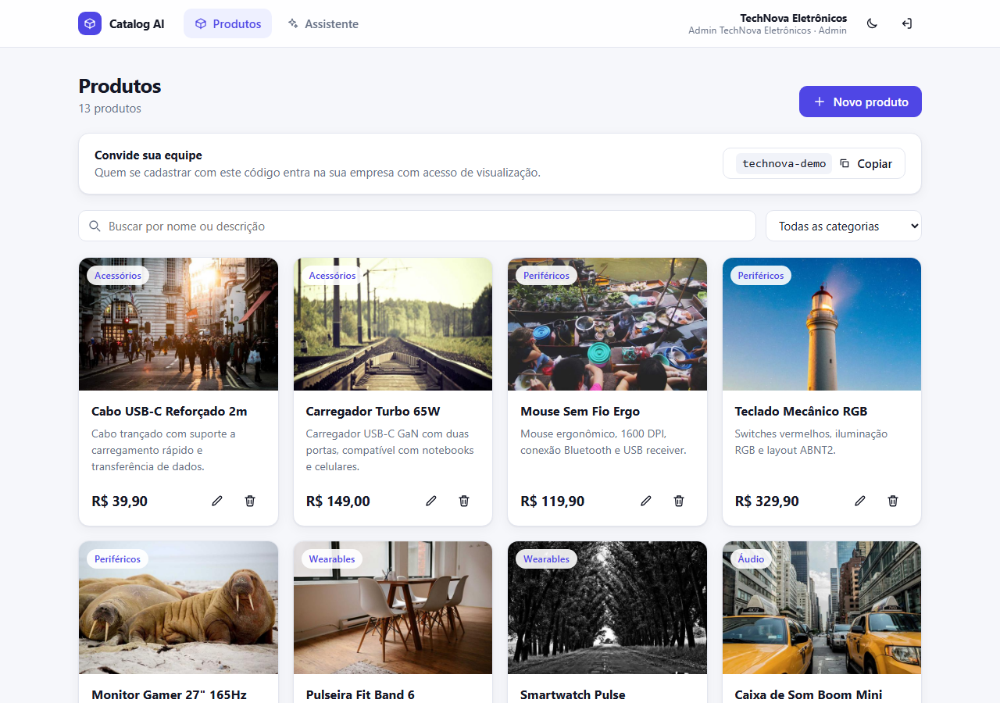
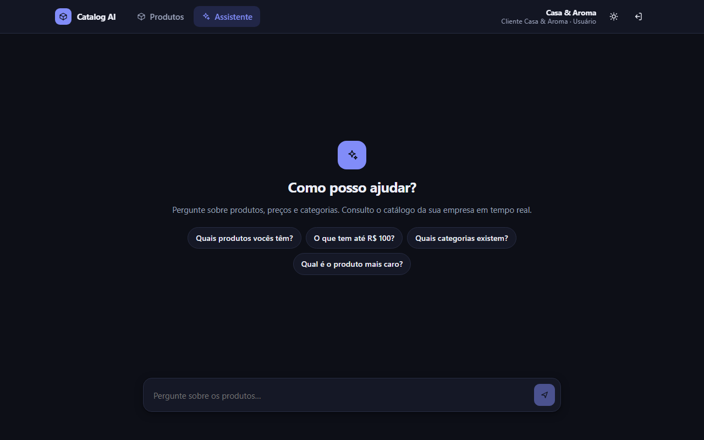
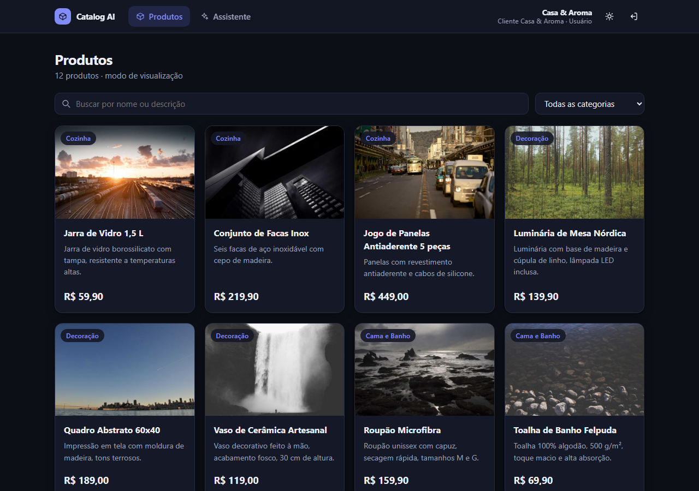
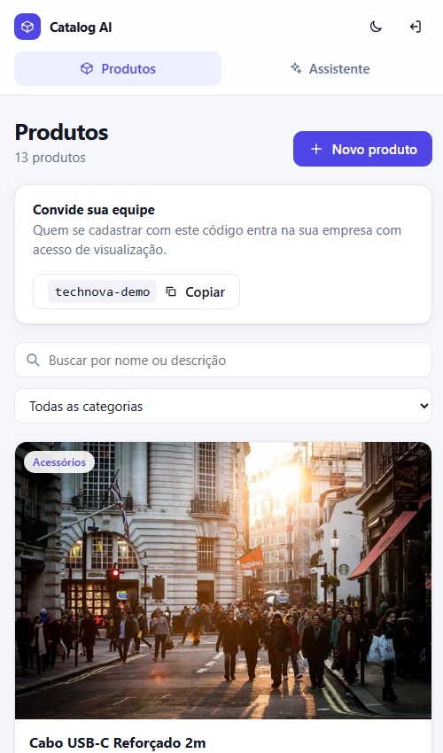

# Catalog AI

Mini SaaS **multi-tenant**: cada empresa cadastra o próprio catálogo de produtos e um **agente de IA** responde às perguntas dos clientes consultando o banco de verdade (tool calling), sempre restrito aos dados da empresa de quem está logado.



| Chat com o assistente (dark mode) | Visão do usuário (somente leitura) | Mobile |
|---|---|---|
|  |  |  |

## O que tem aqui

- **Backend:** Node.js + Express + MongoDB (Mongoose), TypeScript estrito.
- **Auth:** JWT, roles `admin` e `user`, middleware de permissões.
- **Multi-tenant:** isolamento por `company_id` imposto em duas camadas (repositório + plugin do Mongoose).
- **Agente de IA:** loop de tool calling com qualquer modelo do OpenRouter (Claude, OpenAI, modelos gratuitos...), com **streaming SSE**.
- **Frontend:** React + TypeScript (Vite), responsivo, **dark mode**.
- **Upload de imagem** de produto (PNG, JPEG, WebP, até 2 MB), com validação pelos bytes do arquivo.
- **Extras:** Docker Compose, seed, **80 testes automatizados** (61 backend, 19 frontend).

## Rodando em ~5 minutos

### Opção 1: Docker Compose (recomendada)

Requisitos: Docker com Compose v2.

```bash
cp .env.example .env
```

Edite o `.env` e configure a chave do OpenRouter:

```bash
OPENROUTER_API_KEY=sk-or-...
# Opcional: o padrão é um modelo gratuito em preview, que pode mudar ou sair do ar.
# LLM_MODEL=anthropic/claude-haiku-5-5
```

Depois:

```bash
docker compose up --build -d      # mongo + api + web
docker compose run --rm seed      # 2 empresas, 25 produtos, 4 usuários
```

Abra **http://localhost:8080**.

Sem chave de IA tudo funciona, exceto o chat, que responde `503` com uma mensagem explicando o que falta.

Para parar: `docker compose down` (acrescente `-v` para apagar os dados).

### Opção 2: Local (sem Docker para a aplicação)

Requisitos: Node 22+ e um MongoDB acessível.

```bash
docker run -d --name catalog-mongo -p 27017:27017 mongo:7   # ou use um Mongo local

cp .env.example api/.env      # preencha a chave de IA
cd api && npm install && npm run seed && npm run dev          # API em :3000
cd web && npm install && npm run dev                          # web em :5173
```

O Vite encaminha `/api/*` para `http://localhost:3000`, então não há CORS no desenvolvimento.

### Usuários do seed

Senha de todos: `senha1234`

| Empresa | Perfil | E-mail | Código de convite |
|---|---|---|---|
| TechNova Eletrônicos (eletrônicos) | admin | `admin@technova.example` | `technova-demo` |
| TechNova Eletrônicos | user | `user@technova.example` | |
| Casa & Aroma (casa e decoração) | admin | `admin@casaaroma.example` | `casaaroma-demo` |
| Casa & Aroma | user | `user@casaaroma.example` | |

**Roteiro sugerido para testar o isolamento:** entre como `user@casaaroma.example` e pergunte *"Tem vela de lavanda? E algum notebook?"*; depois entre como `user@technova.example` e faça a mesma pergunta. Cada um só enxerga o próprio catálogo.

### Variáveis de ambiente

| Variável | Padrão | Descrição |
|---|---|---|
| `JWT_SECRET` | (obrigatória, mín. 16 chars) | Segredo de assinatura dos tokens |
| `JWT_EXPIRES_IN` | `1d` | Validade do token |
| `OPENROUTER_API_KEY` | | Chave do OpenRouter (obrigatória para o chat) |
| `LLM_MODEL` | `dots-studio/dots-3-note-preview:free` | Modelo do OpenRouter com suporte a tool calling (ex.: `anthropic/claude-haiku-5-5`) |
| `UPLOAD_DIR` | `uploads` | Pasta das imagens enviadas (no Compose, volume `uploads-data` montado em `/app/uploads`) |
| `WEB_PORT` | `8080` | Porta do frontend no Compose |
| `MONGODB_URI`, `PORT`, `CORS_ORIGIN` | | Só para execução local; o Compose define sozinho |

As variáveis são validadas com zod na inicialização: se algo estiver errado, a API não sobe e diz o motivo.

### Testes e qualidade

```bash
cd api && npm test && npm run typecheck && npm run lint    # 61 testes (Mongo em memória)
cd web && npm test && npm run build && npm run lint        # 19 testes
```

Os testes do backend usam `mongodb-memory-server` (baixa um binário do Mongo na primeira execução) e um LLM simulado: **nenhum teste chama um provedor de IA de verdade**, mesmo que exista uma chave no `.env`.

## API

Todas as rotas, exceto `/auth/register`, `/auth/login` e `/health`, exigem `Authorization: Bearer <jwt>`.

| Método e rota | Quem | Descrição |
|---|---|---|
| `POST /auth/register` | público | Cria empresa nova (vira `admin`) com `companyName`, **ou** entra numa existente com `inviteCode` (vira `user`) |
| `POST /auth/login` | público | Retorna `{ token, user }` |
| `GET /auth/me` | autenticado | Usuário e empresa (o `inviteCode` só aparece para admin) |
| `GET /products` | admin, user | Filtros `q`, `category`, `minPrice`, `maxPrice`, `page`, `limit` |
| `GET /products/categories`, `GET /products/:id` | admin, user | |
| `POST /products`, `PUT /products/:id`, `DELETE /products/:id` | **só admin** | `403` para `user` |
| `PUT /products/:id/image`, `DELETE /products/:id/image` | **só admin** | Upload `multipart/form-data` (campo `image`) ou remoção da imagem |
| `POST /chat` | admin, user | `{ message, history? }`. Com `Accept: text/event-stream` responde por SSE (`text`, `tool`, `done`, `error`); senão, JSON `{ reply, toolCalls }` |

`GET /uploads/<companyId>/<arquivo>` serve as imagens enviadas (público, sem token; ver "Upload de imagens").

Erros seguem sempre o formato `{ "error": { "message", "details?" } }`.

## Decisões arquiteturais

### Estrutura do backend

```
api/src
├── config/        env (zod) e conexão com o Mongo
├── lib/           erros da aplicação, plugin de tenant
├── middlewares/   authenticate, requireRole, validate, errorHandler
├── modules/
│   ├── auth/      user model, token JWT, schemas, service, controller, routes
│   ├── companies/ company model
│   ├── products/  model, repository, schemas, service, controller, routes
│   └── chat/      agente, tools, prompt, clientes de LLM, SSE
├── seed/          dados de demonstração (idempotente)
├── app.ts         monta o Express (sem abrir porta, para ser testável)
└── server.ts      sobe a porta e trata o shutdown
```

Camadas por módulo: **routes → controller → service → repository/model**. O controller só traduz HTTP, a regra de negócio fica no service e o acesso a dados no repository. `app.ts` é separado de `server.ts` e recebe o cliente de LLM por parâmetro (`createApp({ llm })`), o que permite testar rotas com `supertest` e um LLM simulado, sem rede.

### Multi-tenant: o isolamento não depende de "lembrar de filtrar"

Escolhi **um banco compartilhado com `company_id` em cada documento** (e não banco por tenant): é o modelo mais simples de operar para muitos tenants pequenos, e o isolamento é reforçado em código:

1. **O tenant vem só do JWT.** O `company_id` é lido de `req.auth` (token verificado), nunca do body, da query ou de parâmetros. Os schemas de entrada são `strictObject`: enviar `company_id` no body retorna `400`.
2. **Repositório "sem como esquecer".** Toda função recebe `companyId` como primeiro argumento obrigatório.
3. **Rede de segurança no model** (`lib/tenantScope.ts`, plugin do Mongoose): qualquer `find`/`update`/`delete`/`count` sem um `company_id` concreto **lança erro**, inclusive filtros com operadores como `{ $ne: id }` (que casariam com outros tenants). `aggregate` precisa começar com `$match` por tenant. `company_id` é imutável em updates.
4. **`404`, não `403`**, ao acessar o recurso de outra empresa: não revela que o id existe.

Os testes cobrem listagem, leitura, edição, exclusão, busca e categorias entre duas empresas, tanto no repositório quanto via HTTP e via chat.

`User` e `Company` ficam de fora do plugin de propósito: o login busca por e-mail *antes* de saber o tenant.

### Auth e permissões

- JWT HS256 com `sub`, `companyId` e `role`; na verificação o algoritmo é **fixado** (há teste com token `alg: none`).
- Senhas com bcrypt (custo 10), `select: false` no hash. O login responde igual para e-mail inexistente e senha errada e gasta o mesmo tempo nos dois casos (hash descartável), para não permitir enumerar contas.
- `authenticate` + `requireRole('admin')` como middlewares compostos nas rotas. A permissão é checada no servidor; esconder botões no frontend é só UX.
- **Como um `user` entra numa empresa?** O desafio não define. Escolhi um **código de convite** por empresa (visível só para o admin): aceitar um `companyId` no registro deixaria qualquer pessoa entrar na empresa de outra.
- Rate limit: 30 requisições/15 min em register e login (por IP) e 20 mensagens/min no chat (**por usuário**, porque cada chamada custa tokens). `helmet`, CORS restrito e limite de 100 kb no body.

### Agente de IA

O `POST /chat` roda um **loop de tool calling real** (`chat.agent.ts`): o modelo decide se precisa de uma ferramenta, o servidor executa, devolve o resultado e o modelo redige a resposta, com limite de 5 iterações.

- **Tools:** `search_products` (texto, categoria, faixa de preço, limite) e `list_categories`. Os schemas são zod e viram o JSON Schema enviado ao modelo, então há uma única fonte de verdade.
- **O modelo nunca escolhe o tenant.** O `companyId` é injetado pelo servidor a partir do JWT; o schema da tool nem tem esse campo, e argumentos extras são descartados. Há teste simulando um modelo que tenta passar o `company_id` de outra empresa.
- **Erros de tool voltam ao modelo** como `is_error` (ferramenta desconhecida, parâmetros inválidos), para ele se corrigir, em vez de derrubar a requisição.
- **Prompt injection:** o system prompt manda tratar nomes e descrições de produtos como dados, não instruções. A defesa que realmente importa é estrutural: mesmo que o modelo seja enganado, as tools só alcançam o tenant do usuário.
- **OpenRouter:** uma única API compatível com OpenAI dá acesso a Claude, GPT e modelos gratuitos, e o modelo se troca por `LLM_MODEL`, sem mudar código. Validei o fluxo completo (login → chat → tool → resposta em streaming) com chave real e o modelo padrão; outros modelos dependem de suporte a tool calling no OpenRouter.
- **Interface `LlmClient`:** o agente depende só dela, com formato de mensagens neutro (`llm.ts`) e um adaptador para o formato OpenAI (`openai-format.ts`). Trocar de provedor (por exemplo, o SDK nativo da Anthropic) é escrever outra implementação, e os testes usam um LLM roteirizado e determinístico.
- **Loop próprio em vez de LangChain:** para este escopo (duas tools e um loop curto, com tenant injetado e streaming SSE), usar o cliente OpenAI-compatível direto deixa cada passo (chamada do modelo → execução da tool → resultado devolvido) visível, testável e fácil de explicar, sem camadas de abstração. Como a lógica está atrás da interface `LlmClient`, migrar para LangChain/LangGraph é uma troca localizada; eu faria isso quando houver vários agentes, memória de conversa, RAG ou orquestração entre modelos.
- **Streaming por SSE** em vez de WebSocket: o fluxo é unidirecional (servidor → cliente), SSE é HTTP puro (passa por proxies, sem handshake), e o cliente cancela abortando o `fetch`, o que também aborta a chamada ao LLM. O frontend usa `fetch` + stream porque `EventSource` não faz POST nem envia `Authorization`. WebSocket passaria a valer a pena com comunicação bidirecional (presença, transferência para atendente humano, múltiplos dispositivos na mesma conversa).
- **Busca:** cada palavra da consulta precisa casar em nome, descrição ou categoria, em qualquer ordem, e o texto do usuário é escapado antes de virar regex. Esse ponto apareceu no teste real: "vela de lavanda" não achava "Vela Aromática Lavanda" na primeira versão.

### Upload de imagens

- **Armazenamento atrás de uma interface** (`ImageStorage`, `modules/uploads`): hoje grava em disco, em `uploads/<companyId>/<uuid>.<ext>`, com volume no Compose para sobreviver a recriações do container. Trocar por S3/GCS é escrever outra implementação; não usei S3 agora para manter o setup em 5 minutos, sem conta de nuvem.
- **O tipo é decidido pelos bytes**, não pelo `Content-Type` nem pelo nome do arquivo (o cliente pode forjar os dois). Só PNG, JPEG e WebP; **SVG é recusado** porque pode carregar scripts. Limite de 2 MB (`413`) e um arquivo por requisição.
- **Multi-tenant:** o produto é buscado pelo `companyId` do JWT antes de qualquer gravação (`404` para outra empresa), e o arquivo vai para a pasta da própria empresa. O nome é gerado no servidor (UUID), então não há path traversal, e `imageUrl` no body só aceita `http(s)`, o que impede apontar para o arquivo de outra empresa.
- **Sem arquivos órfãos:** substituir, remover a imagem, trocar por uma URL externa ou excluir o produto apaga o arquivo antigo; se a gravação no banco falha, o arquivo novo é descartado.
- **Leitura pública:** `` não envia `Authorization`, então `/uploads` é público. A proteção é o nome aleatório (UUID, impossível de adivinhar) e a listagem de pastas desativada. Em produção: URLs assinadas com expiração ou CDN com acesso restrito.

### Frontend

- **Vite + React + TypeScript**: o desafio pede só React + TS, e o Vite é o toolchain recomendado para SPAs. Next.js traria SSR e API routes que o projeto não usa, já que há uma API separada.
- **TanStack Query** para estado de servidor (cache, invalidação após mutações), contexto simples para a sessão, e CSS próprio com variáveis (tokens) em vez de uma biblioteca de UI: menos dependências e controle total do dark mode.
- Dark mode respeita `prefers-color-scheme`, persiste a escolha e evita o "flash" de tema trocando o atributo antes do React montar.
- Estados de carregamento, erro e vazio em todas as telas, `<dialog>` nativo nos modais (foco e ESC de graça), `prefers-reduced-motion`, layout responsivo.
- Um `401` em qualquer chamada encerra a sessão.

### Infra

Docker Compose com `mongo` (healthcheck e volume), `api` (build multi-stage, só dependências de produção, usuário não-root) e `web` (nginx servindo o build e encaminhando `/api` para a API no mesmo domínio, com `proxy_buffering off` para o SSE não ser retido). O seed é um job à parte (`docker compose run --rm seed`) porque se recusa a rodar com `NODE_ENV=production`.

## O que eu faria diferente em produção

**Escala**
- API stateless: escala horizontalmente atrás de um load balancer. Rate limit em Redis (hoje é em memória, por instância).
- MongoDB em **replica set** (alta disponibilidade e transações; hoje o registro compensa manualmente a criação da empresa se a do usuário falhar). Chave de sharding começando por `company_id`.
- Busca com índice de texto ou Atlas Search / OpenSearch (hoje é regex com `company_id` no índice, adequado para catálogos pequenos), e paginação por cursor.
- Chat: fila ou limite de concorrência para o provedor de LLM, cota e orçamento por tenant, cache de consultas frequentes e *fallback* entre modelos.
- Tempo real: se o chat evoluir para atendimento com humanos, WebSocket com adaptador de pub/sub (Redis) para várias instâncias da API.
- Imagens: S3/GCS com URLs assinadas e CDN no lugar do disco local (que não escala para várias instâncias da API), redimensionamento/otimização (thumbnails, WebP) e varredura de arquivos.

**Segurança**
- Tokens de acesso curtos + **refresh token** rotativo com revogação, em cookie `httpOnly` + proteção CSRF. Hoje o JWT fica no `localStorage` (simples, mas exposto a XSS) e dura 1 dia.
- Segredos em um secrets manager, rotação de chaves, e-mail verificado, política de senhas e MFA para admins.
- Convites por e-mail com expiração e uso único, no lugar do código fixo por empresa. Auditoria de ações administrativas.
- CSP e demais headers de segurança no nginx, varredura de dependências e imagens no CI.
- Para clientes enterprise, opção de banco dedicado por tenant. Revisão de privacidade do que é enviado ao provedor de LLM (contrato, retenção, dados pessoais).

**Monitoramento e operação**
- Logs estruturados (ex.: pino) com `requestId`, `userId` e `companyId`; métricas (latência, taxa de erro, saturação do Mongo) e tracing com OpenTelemetry; Sentry para erros do frontend e do backend.
- Observabilidade do agente: traces por conversa (prompt, tools chamadas, latência, tokens e custo por tenant) com Langfuse ou LangSmith, mais um conjunto de avaliações (perguntas com respostas esperadas) rodando no CI para pegar regressões ao trocar de modelo ou de prompt.
- Probes de liveness e readiness, alertas (taxa de erro, p95, custo do LLM), backups e teste de restauração do banco.
- CI com lint, testes e build, mais testes ponta a ponta (Playwright) do fluxo login → CRUD → chat.

## Limitações conhecidas

- O upload guarda a imagem como enviada, sem redimensionar ou otimizar, e o armazenamento em disco local não serve para várias instâncias da API.
- Os testes automatizados não chamam um LLM real; a integração com o provedor foi validada manualmente (veja o roteiro acima). Modelos gratuitos do OpenRouter podem oscilar ou ter limite de requisições; o padrão é um modelo em *preview*, então pode ser preciso trocar `LLM_MODEL`.
- Não há testes ponta a ponta de navegador; os testes de frontend cobrem o streaming, as permissões e os fluxos principais com a API simulada.
- Não há recuperação de senha nem verificação de e-mail.
